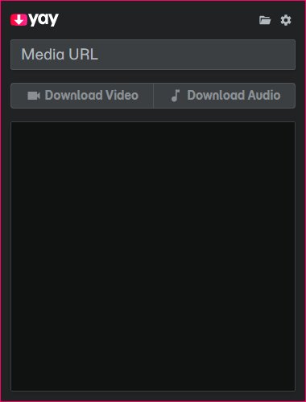
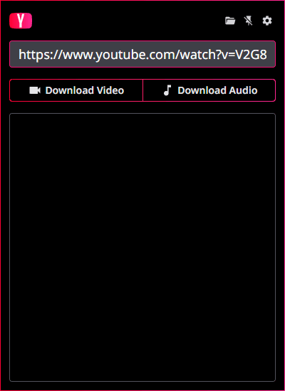
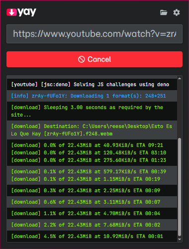
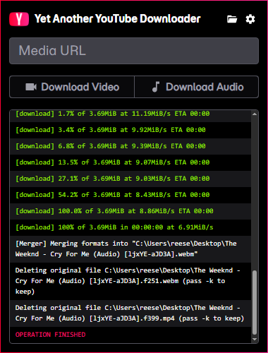

# yay

_yay_ (**Y**et **A**nother **Y**ouTube Downloader) is a lightweight, [WebView2](https://developer.microsoft.com/en-us/microsoft-edge/webview2)-based GUI wrapper for [yt-dlp](https://github.com/yt-dlp/yt-dlp) on Windows, running in the system tray. Despite the name, yay can download from any site supported by yt-dlp.

## Installation

yay can be installed by downloading and running the latest setup from the [releases](https://github.com/depthbomb/yay/releases/latest) page.

The native application requires 64-bit Windows 10 or later and the Microsoft Edge WebView2 Runtime. If the runtime is missing when yay starts, the app offers to download it from Microsoft and install it silently.

On first run, yay checks for yt-dlp and Deno using its configured paths, which default to the system PATH. It also checks for FFmpeg and FFprobe in its `bin` folder. If files are missing, yay asks before downloading them, using [yt-dlp's builds of FFmpeg and FFprobe](https://github.com/yt-dlp/FFmpeg-Builds).

## Screenshots






## Development

The native host uses C++23 and WebView2. The frontend uses React, TypeScript, and Vite, and is embedded in the executable during the build.

Install these development tools:

- Visual Studio 2026 or Build Tools 2026 with the MSVC C++ toolchain and Windows SDK.
- CMake 4.4 or later.
- [Bun](https://bun.com/docs/installation) 1.4 or later and Node.js 24 for the frontend test runner.
- PowerShell 7 (`pwsh` on PATH).

Run these commands from the project root:

```powershell
pwsh -NoProfile -File scripts/prepare.ps1
cmake --preset debug
cmake --build --preset debug --parallel
ctest --preset debug
```

The preparation script downloads the WebView2 SDK to `%LOCALAPPDATA%\yay-build-deps` and restores the locked dependencies in `ui`.

Run `build/debug/Debug/yay.exe` to launch the Debug build. CTest covers the native services, frontend, generated contracts, and native window behavior. Download integration tests are enabled when yt-dlp and FFmpeg are on PATH; tests that download setup dependencies are opt-in with `YAY_TEST_ONLINE_SETUP=ON`.

For a Release build:

```powershell
cmake --preset release
cmake --build --preset release --parallel
ctest --preset release
```

Release validation checks that the executable and embedded frontend exclude Debug hooks and tests. CLion can open the root `CMakeLists.txt` and use the supplied presets.

Frontend-only checks run from `ui`: `bun run typecheck`, `bun run test`, and `bun run test:protocol`. After dependency changes, include the updated `ui/bun.lock`.

### Shared contracts and product information

Edit IPC and settings schemas in `protocol`, then run `bun scripts/generate_ipc.mjs`. CMake generates fresh randomized IPC channel values for each build under `build/<preset>/ipc/<configuration>` and uses the same values for C++ and TypeScript. The checked-in TypeScript contracts use readable values for editing and tests. Channel randomization is obfuscation, not an authentication mechanism.

Use the generated `SettingsKey` enum in TypeScript and `ipc::SettingsKey` in C++. Both come from `protocol/settings.ts`. The native settings service accepts enum keys, and serialization keeps the existing names in IPC messages and `yay.cfg`.

Product constants live in `protocol/product.json`; release history lives in `protocol/changelog.json`. Run `bun scripts/generate_product.mjs` to update the generated C++ header, TypeScript constants, installer definitions, and `CHANGELOG.md`. CMake also runs this generator when either source changes. Edit the source JSON rather than the generated files.

The changelog keeps version headings, Markdown bullets, nested bullets, optional descriptions, and separators. A nested array in a release's `changes` list becomes a sublist of the preceding bullet. To print one release's notes for GitHub:

```powershell
bun scripts/generate_product.mjs --release 2.0.0
```

Use `bun scripts/generate_product.mjs --check` to check for stale generated files without changing them.

## Distribution

Install [Inno Setup 7.1 or later](https://jrsoftware.org/isinfo.php) and put `ISCC.exe` on PATH, then run:

```powershell
cmake --preset distribution
cmake --build --preset distribution --parallel
```

This builds and validates Release, stages the runnable application in `dist/yay`, and creates `dist/yay-setup.exe` plus its SHA-256 checksum beside that folder. The installer is native x64 and uses UTC file timestamps. The package includes the required runtime DLLs, assets, bundled utilities, and license notices. The bundled archive utility comes from `assets/bin`; a separate 7-Zip installation is not required.

## Feature Flags

This application uses feature flags to enable or disable certain functionality at runtime. Feature flags are defined in a `features.toml` file in the app's data folder, accessible by clicking the _Open data folder_ button in application settings. The application **must be restarted** after modifying feature flags for changes to take effect.
